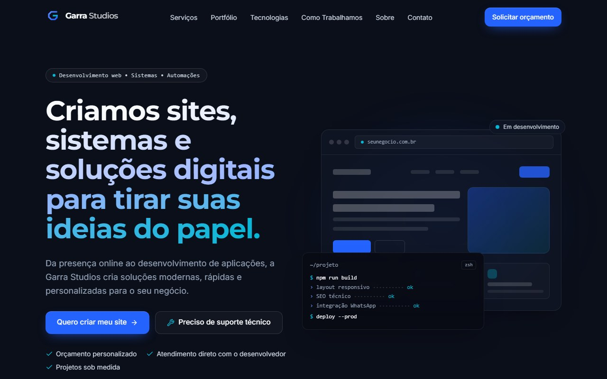

<div align="center">

# Garra Studios — site oficial

**Site institucional da [Garra Studios](https://garrastudios.online): criação de sites, landing pages, sistemas web, automações, suporte técnico e parcerias com agências.**

[](https://garrastudios.online)


<br>



</div>

## Destaques

- **Exportação estática:** o build gera arquivos prontos servidos direto pelo Nginx. Sem Node, banco ou processo extra no servidor.
- **SEO técnico completo:** metadata, canonical, Open Graph gerado no build, JSON-LD, `sitemap.xml`, `robots.txt`, `llms.txt` e 404 real.
- **Contato sem back-end:** o formulário valida os campos e monta a mensagem para o WhatsApp no navegador, com serviço pré-selecionado por URL.
- **Performance e acessibilidade:** JavaScript só onde é necessário, FAQ com `<details>` nativo, animações em CSS com `prefers-reduced-motion`.
- **Testes end-to-end:** Playwright em desktop (1440px) e mobile (Pixel 7), cobrindo navegação, menu, FAQ, formulário, SEO e 404.
- **Deploy com rollback:** publicação com troca atômica de versão e retorno instantâneo à anterior.

---

---

## Sumário

1. [Desenvolvimento local](#1-desenvolvimento-local)
2. [Variáveis de ambiente](#2-variáveis-de-ambiente)
3. [Estrutura do projeto](#3-estrutura-do-projeto)
4. [Editando conteúdo](#4-editando-conteúdo)
5. [Identidade visual (logo provisório)](#5-identidade-visual)
6. [Qualidade: lint, tipos, build e testes](#6-qualidade)
7. [SEO e indexação](#7-seo-e-indexação)
8. [Publicação na VPS (Nginx existente)](#8-publicação-na-vps)
9. [Atualização e rollback](#9-atualização-e-rollback)
10. [Segurança](#10-segurança)
11. [Lançamento x próximas etapas](#11-lançamento-x-próximas-etapas)

---

## 1. Desenvolvimento local

Requisitos: Node.js 20.9+ (recomendado 22 LTS) e npm.

```bash
npm ci
cp .env.example .env.local   # preencha NEXT_PUBLIC_WHATSAPP_NUMBER
npm run dev                  # http://localhost:3000
```

Build de produção e prévia local dos arquivos gerados:

```bash
npm run build      # gera out/
npm run preview    # serve out/ em http://localhost:3000 (mesmo comportamento do Nginx)
```

## 2. Variáveis de ambiente

| Variável | Obrigatória | Descrição |
|---|---|---|
| `NEXT_PUBLIC_WHATSAPP_NUMBER` | Sim (para o formulário) | Só dígitos, com DDI + DDD (formato `55DDNNNNNNNNN`). Vazio → o site mostra "Canal de contato em configuração" no lugar do formulário. |
| `NEXT_PUBLIC_GOOGLE_SITE_VERIFICATION` | Não | Código da meta tag do Google Search Console (prefira verificação por DNS). |
| `NEXT_PUBLIC_BING_SITE_VERIFICATION` | Não | Código `msvalidate.01` do Bing Webmaster Tools. |

> **Importante:** variáveis `NEXT_PUBLIC_*` são **públicas** e são **embutidas nos arquivos durante o build**. Não coloque segredos nelas. Alterar o número de WhatsApp exige **publicar de novo** (`npm run publish`).

Nenhuma senha, token ou chave deve ir para este repositório. `.env` e `.env.*` estão no `.gitignore`.

## 3. Estrutura do projeto

```
app/                      rotas (App Router)
  layout.tsx              fontes, metadata global, JSON-LD, header/footer
  page.tsx                home (compõe as seções)
  politica-de-privacidade/
  not-found.tsx           404
  sitemap.ts robots.ts manifest.ts llms.txt/route.ts
  icon.svg apple-icon.tsx opengraph-image.tsx
components/
  brand/Logo.tsx          símbolo e logo horizontal (provisórios)
  layout/                 Header, MobileMenu (<dialog>), Footer
  sections/               uma seção por arquivo
  contact/ContactForm.tsx formulário → WhatsApp
  visuals/                ilustrações do hero e mockups conceituais (HTML/CSS)
  ui/                     Button, Container, SectionHeading
content/site.ts           TODO o texto do site
lib/                      config, whatsapp, validação, JSON-LD
public/brand/             arquivos SVG da marca
tests/                    testes Playwright
scripts/                  servidor estático local, variante de teste, capturas de tela
deploy/                   configuração do Nginx, publish.sh e rollback.sh
```

Componentes de cliente (JavaScript no navegador) só onde é necessário: menu mobile, formulário e ano do rodapé. O FAQ usa `<details>` nativo e as animações de entrada usam CSS (*scroll-driven animations*), sem JavaScript. Tudo respeita `prefers-reduced-motion`.

## 4. Editando conteúdo

- **Textos, serviços, FAQ, tecnologias e etapas:** `content/site.ts`.
- **Nome, URL, descrição e data de atualização do conteúdo:** `lib/config.ts` (atualize `contentUpdatedAt` quando mudar textos; ela alimenta o `sitemap.xml`).
- **Política de privacidade:** `app/politica-de-privacidade/page.tsx`. Se forem adicionados analytics, cookies, e-mail ou outro tratamento de dados, **atualize a política antes**.

Regra do projeto: **não publicar** clientes, depoimentos, números, portfólio, prêmios ou dados empresariais que não sejam reais e confirmados.

### Links de contato com serviço pré-selecionado

Qualquer link `/?servico=<slug>#contato` abre o formulário com o serviço escolhido. Slugs: `site`, `landing-page`, `loja-virtual`, `sistema-web`, `automacao`, `correcao-bugs`, `infraestrutura`, `parceria-agencia`, `outro`. Use `contactHref("slug")` em `content/site.ts`.

## 5. Identidade visual

| Token | Cor | Uso |
|---|---|---|
| Azul principal | `#2563FF` | botões, ícones, destaques (como texto pequeno, use `#6E95FF` por contraste) |
| Azul de apoio | `#06B6D4` | gradientes, indicadores (nunca texto branco sobre ele) |
| Grafite | `#0B0F1A` | fundo |
| Cinza | `#1F2937` | superfícies e bordas |
| Branco | `#F8FAFC` | texto principal |
| Texto secundário | `#94A3B8` | adicionado para manter contraste AA |

Tipografia: **Montserrat** (títulos) e **Inter** (texto), auto-hospedadas via `next/font` (sem requisições ao Google em tempo de execução).

> ⚠️ **Logo provisório.** Não havia SVG original na pasta do projeto; o "G" geométrico angular foi **reconstruído** e precisa ser **aprovado** ou substituído pelo arquivo oficial. Versões em `public/brand/`: horizontal (fundo escuro, fundo claro, monocromática), símbolo (fundo escuro, fundo claro, monocromático) e favicon. Para trocar: substitua os SVGs, atualize `LOGO_G_PATH`/`LOGO_BAR_PATH` em `components/brand/Logo.tsx` e `app/icon.svg`. Nas versões horizontais em SVG o texto usa a fonte Montserrat; para uso definitivo fora do site, converta o texto em curvas.

## 6. Qualidade

```bash
npm run lint        # ESLint (core-web-vitals + typescript)
npm run typecheck   # tsc --noEmit
npm run build       # build de produção (out/)
npx playwright install chromium   # uma vez
npm test            # gera os builds e roda o Playwright
```

`npm test` gera dois builds estáticos: o normal (`out/`, porta 3100) e um **sem WhatsApp** (`out-sem-whatsapp/`, porta 3101) para validar o estado informativo. Os dois são servidos por `scripts/serve-static.mjs`, que imita as regras do Nginx. Os testes cobrem: navegação e âncoras, links internos (200), links externos, menu mobile (Esc, foco, fechamento), FAQ (clique e teclado), formulário (erros, pré-seleção por URL, link `wa.me` gerado), endpoints de SEO, metadados, JSON-LD e 404. Projetos: desktop (1440px) e mobile (Pixel 7). Os headers de segurança vêm do Nginx e são conferidos no ar com `curl -I https://garrastudios.online`.

Capturas de tela para revisão visual (com `npm run preview` rodando): `node scripts/screenshots.mjs http://localhost:3000`.

## 7. SEO e indexação

Implementado:

- Metadata por página (title, description, canonical), Open Graph e Twitter Card com imagem gerada (`/opengraph-image`, 1200×630).
- `robots.txt` (rastreamento liberado + sitemap), `sitemap.xml` (só URLs canônicas e indexáveis), `manifest.webmanifest`, favicon SVG e Apple Touch Icon.
- JSON-LD (`Organization`, `WebSite`, `Service`) **apenas com dados reais**: sem endereço, avaliações ou redes sociais. `LocalBusiness` não é usado (pressupõe endereço físico) e `FAQPage` também não (o Google restringiu esse rich result a sites governamentais e de saúde).
- `llms.txt`, gerado a partir de `content/site.ts`. É uma **convenção proposta**: não há evidência de que influencie ranqueamento nem garantia de citação por ferramentas de IA. `llms-full.txt` não foi criado porque o site tem uma página principal e o arquivo duplicaria o conteúdo.
- 404 com `noindex`, HTML semântico (um `h1`, `h2` por seção), skip link e foco visível.
- Sem meta keywords (ignorada pelos buscadores).

### Google Search Console e Bing Webmaster Tools

1. **Google:** adicione uma propriedade do tipo **Domínio** (`garrastudios.online`) e verifique pelo **registro TXT** no DNS da Cloudflare. Isso cobre http/https e www de uma vez, sem mudar código. Alternativa: propriedade de prefixo de URL com meta tag → `NEXT_PUBLIC_GOOGLE_SITE_VERIFICATION` + rebuild.
2. Envie `https://garrastudios.online/sitemap.xml` em *Sitemaps* e use *Inspeção de URL* → "Solicitar indexação" na home.
3. **Bing:** importe a propriedade direto do Google Search Console (mais simples) ou use `NEXT_PUBLIC_BING_SITE_VERIFICATION`.
4. Depois do deploy, valide: [Rich Results Test](https://search.google.com/test/rich-results), [validator.schema.org](https://validator.schema.org), [PageSpeed Insights](https://pagespeed.web.dev) e o compartilhamento do link (Open Graph).

## 8. Publicação na VPS

Ambiente: Ubuntu 26.04, 2 vCPU / 4 GB RAM / 40 GB, com **Nginx já instalado** servindo outros sistemas. O site é só uma pasta de arquivos em `/var/www/garrastudios`, servida pelo Nginx. **Na VPS não roda Node, Docker nem nenhum processo novo**, e o build acontece na sua máquina.

```
/var/www/garrastudios/
  releases/20261111-153000/   versões publicadas (as 5 mais recentes)
  current -> releases/...     link para a versão no ar (o Nginx lê daqui)
```

### 8.1 DNS

`garrastudios.online` → registro A apontando para a VPS e `www` → CNAME `garrastudios.online`, ambos **sem proxy** da Cloudflare (nuvem cinza).

Se um dia o proxy da Cloudflare (nuvem laranja) for ativado, configure **SSL/TLS = Full (strict)**. No modo "Flexible", o redirecionamento HTTP→HTTPS do Nginx gera **loop infinito**.

### 8.2 Certificado

A VPS **já tem** um certificado wildcard `garrastudios.online` + `*.garrastudios.online` (renovação automática via certbot `dns-cloudflare`), usado também por `garra-demos`. **Não emita outro**: a configuração do site reutiliza `/etc/letsencrypt/live/garrastudios.online/`.

### 8.3 Primeira publicação

```bash
# Na sua máquina (Git Bash), com NEXT_PUBLIC_WHATSAPP_NUMBER no .env.local:
DEPLOY_HOST=root@IP_DA_VPS DEPLOY_KEY=~/.ssh/sua_chave npm run publish
```

Na VPS, uma única vez, ative o site no Nginx:

```bash
cp deploy/nginx/garrastudios.online.conf /etc/nginx/sites-available/garrastudios.online   # (copie o arquivo para a VPS)
ln -s /etc/nginx/sites-available/garrastudios.online /etc/nginx/sites-enabled/garrastudios.online
nginx -t && systemctl reload nginx          # testa ANTES de recarregar
#   em caso de erro: rm /etc/nginx/sites-enabled/garrastudios.online   (nada muda)
```

O mesmo Nginx serve outros sites, entre eles as demos em `<slug>.garrastudios.online` (por regex). Os nomes exatos deste site têm prioridade sobre essa regex, então `www` redireciona para o domínio principal.

### 8.4 Verificações

```bash
curl -I http://garrastudios.online          # 301 → https://garrastudios.online/
curl -I https://www.garrastudios.online     # 301 → https://garrastudios.online/
curl -I https://garrastudios.online         # 200 + headers de segurança
curl -I https://garrastudios.online/nao-existe   # 404
# e confirme que os outros sites do servidor continuam respondendo normalmente
```

## 9. Atualização e rollback

```bash
# Publicar uma nova versão (build local + envio + troca instantânea do link "current")
DEPLOY_HOST=root@IP_DA_VPS DEPLOY_KEY=~/.ssh/sua_chave npm run publish

# Voltar para a versão anterior (instantâneo, sem build)
DEPLOY_HOST=root@IP_DA_VPS DEPLOY_KEY=~/.ssh/sua_chave bash deploy/rollback.sh
```

A troca de versão é atômica: o visitante nunca vê o site "pela metade". O `publish.sh` se recusa a publicar se o build não tiver o número de WhatsApp. Não é preciso recarregar o Nginx ao publicar.

Logs de acesso: `/var/log/nginx/garrastudios.access.log` (rotacionados pelo logrotate padrão do Nginx).

## 10. Segurança

- **Headers** (na configuração do Nginx): `Strict-Transport-Security`, `X-Content-Type-Options`, `X-Frame-Options: DENY`, `Referrer-Policy`, `Permissions-Policy` e uma CSP mínima (`frame-ancestors`, `base-uri`, `form-action`, `object-src`). Uma CSP restritiva de `script-src` quebraria os scripts inline do Next.js. Não compensa num site sem login e sem dados enviados ao servidor. HSTS começa sem `preload`.
- **Superfície mínima:** sem processo de aplicação, sem porta nova e sem banco. O Nginx só lê arquivos.
- **Publicação:** acesso à VPS só por chave SSH (`DEPLOY_KEY`); nenhum segredo fica no repositório.

## 11. Lançamento x próximas etapas

**No lançamento (implementado):** todas as seções, formulário → WhatsApp, SEO técnico completo, 404, política de privacidade, publicação estática no Nginx com rollback e testes automatizados.

**Depois (quando houver demanda real):**

- Logo definitivo aprovado e manual de marca.
- Portfólio/cases, **apenas com projetos reais e autorizados**, e depoimentos reais.
- Envio por e-mail com backend próprio (rota + SMTP), se o WhatsApp não bastar.
- Analytics com respeito à privacidade (ex.: Umami/Plausible self-hosted) + atualização da política.
- Blog para SEO de conteúdo; versão em inglês se fizer sentido comercial.
- Proxy da Cloudflare (CDN/WAF) com SSL Full (strict).
